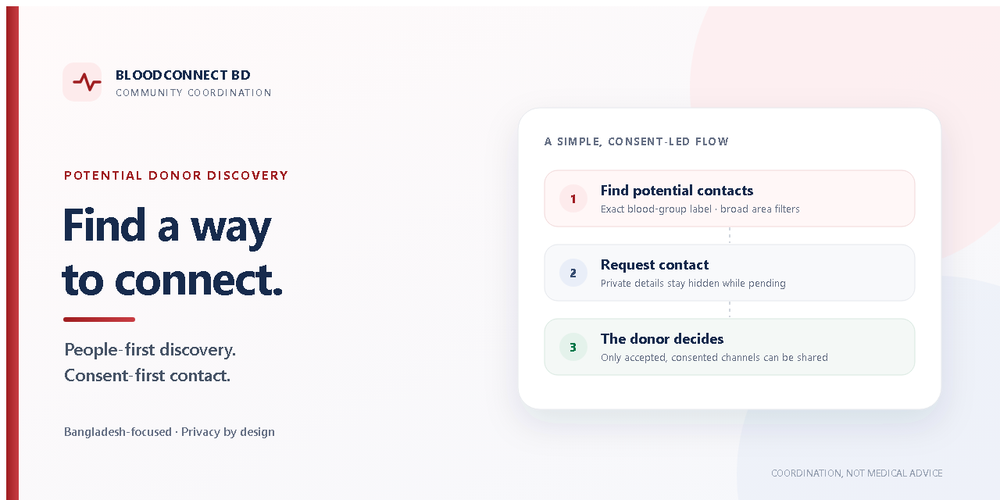
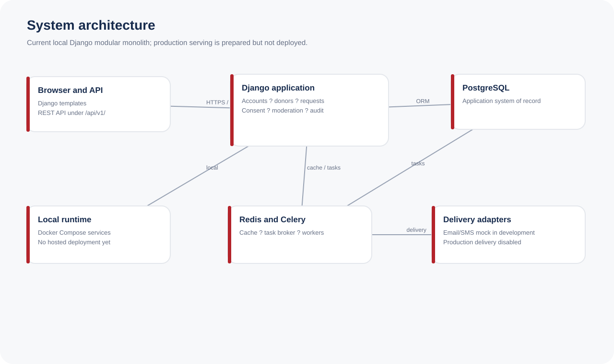
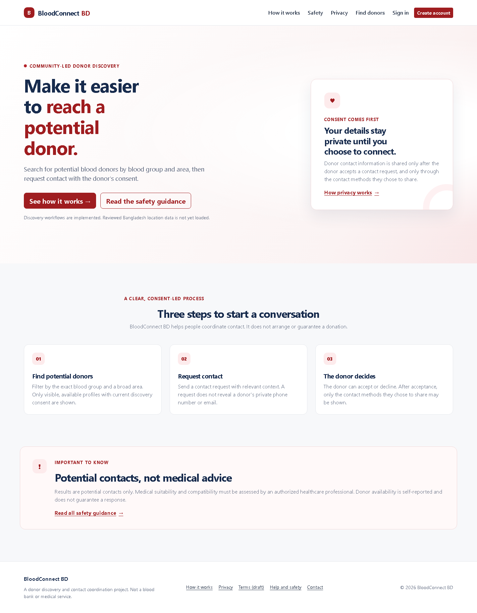
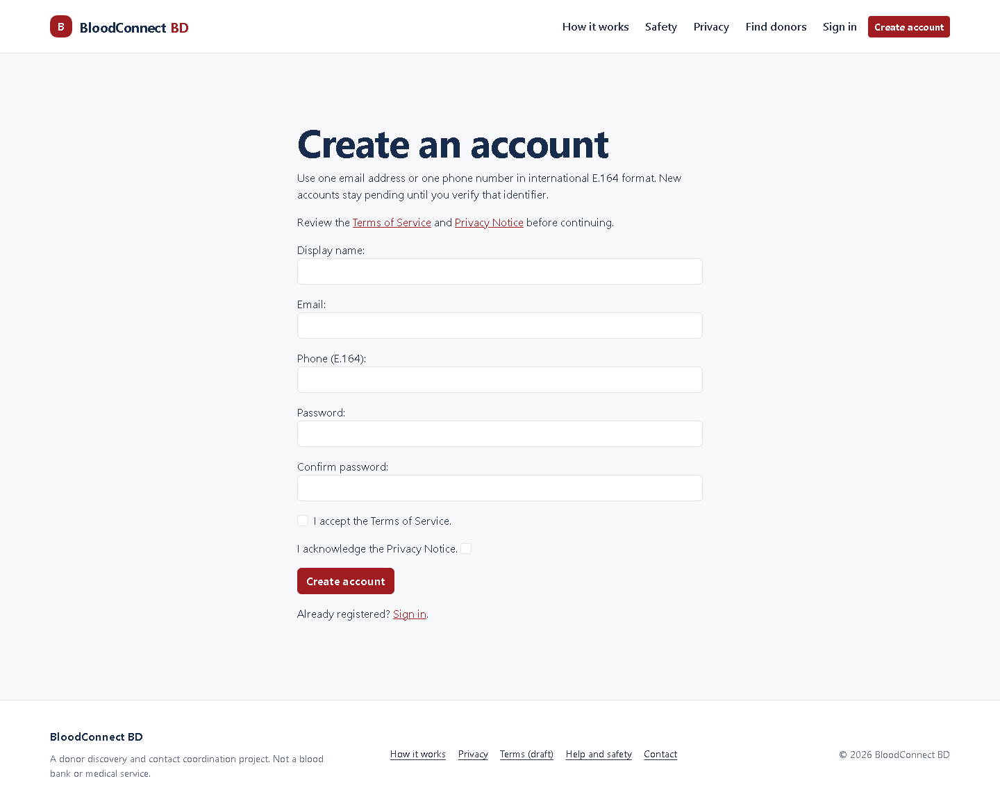
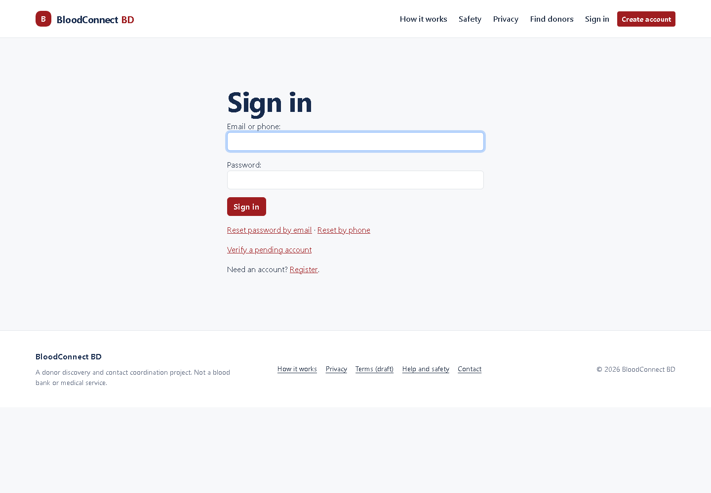
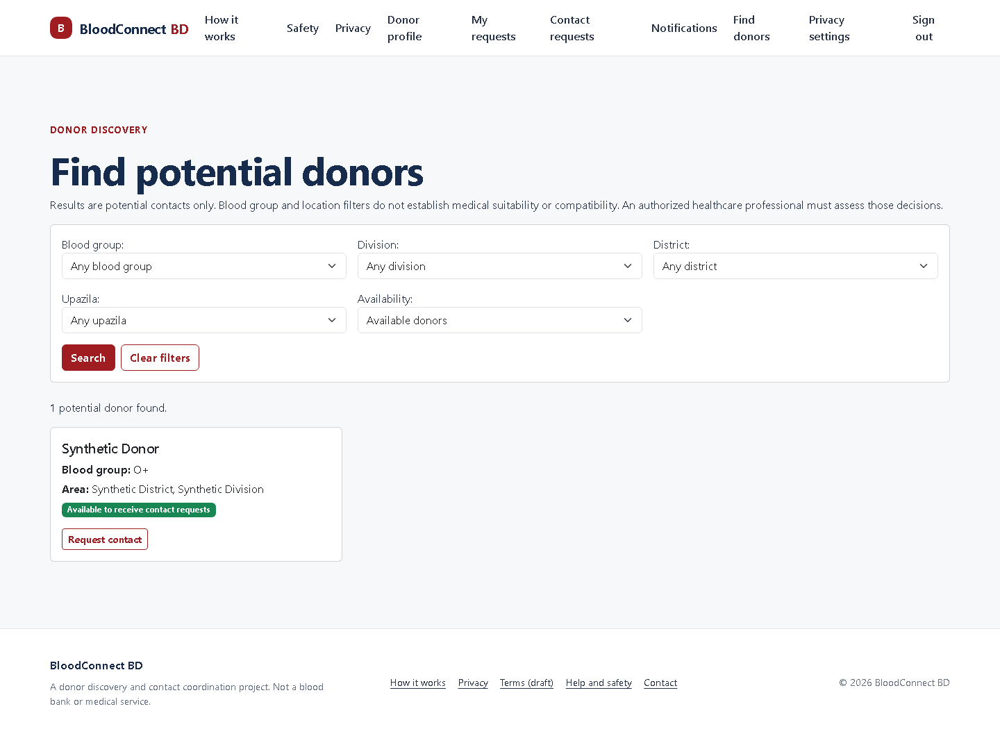
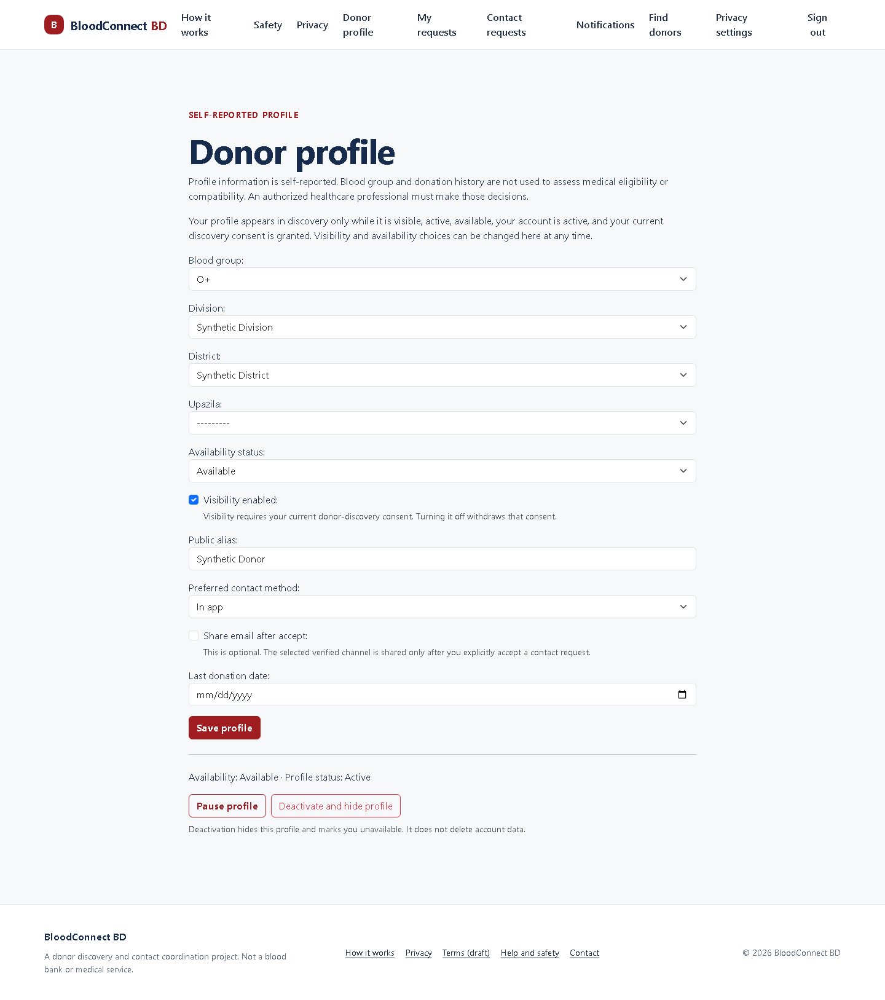
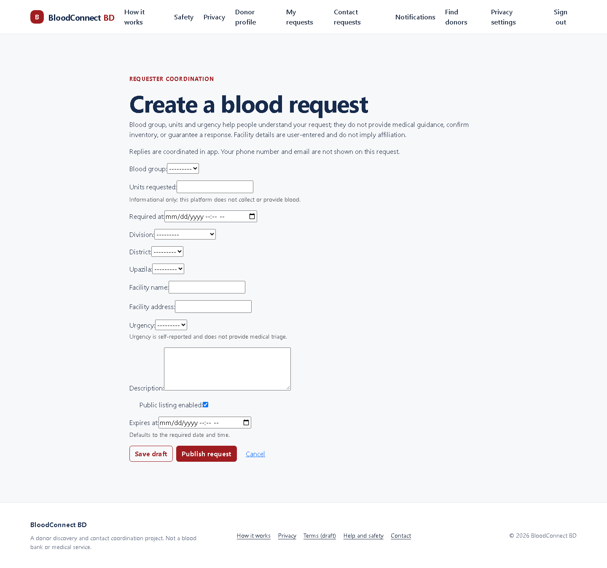
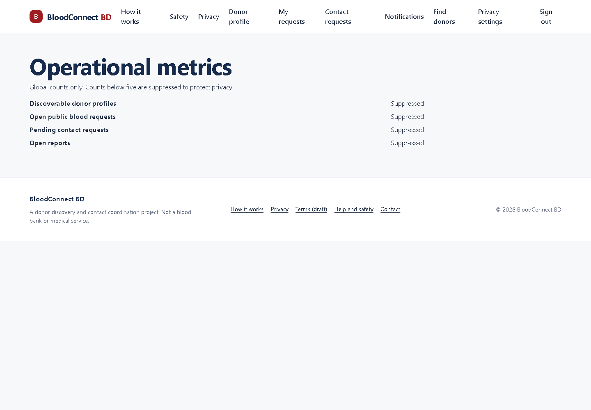
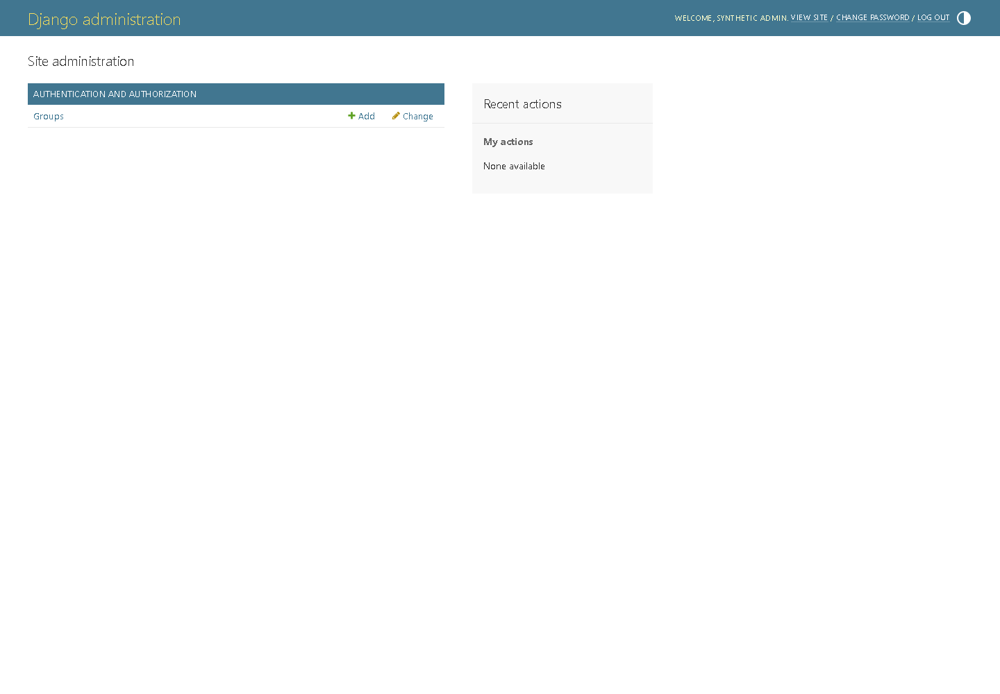

<div align="center">
  

  <h1>BloodConnect BD</h1>
  <p><strong>A privacy-first platform for discovering potential blood donors and coordinating contact.</strong></p>

  <p>
    <a href="https://github.com/shrabon23103039/BloodConnect-BD/actions/workflows/ci.yml"></a>
    <a href="LICENSE"></a>
    
    
    
    
  </p>
</div>

BloodConnect BD is a Bangladesh-focused, peer-to-peer donor discovery and coordination project. Recipients can find potential contacts and send a contact request; donors choose whether to accept before any donor-selected contact channel is disclosed.

> **Safety:** BloodConnect BD is not a blood bank, healthcare provider, or clinical decision-support system. Search results do not establish medical eligibility or compatibility and do not guarantee a response or donation. Clinical decisions belong to qualified healthcare professionals and authorized facilities.

## Why this project

People seeking blood often depend on scattered contacts and informal networks. BloodConnect BD provides structured search and request workflows while keeping donor contact details private until the donor accepts and has opted to share the relevant channel.

## Features

- Account registration, email/phone login, optional Google sign-in, logout, identifier verification seam, and password recovery.
- Donor profiles with self-reported availability, visibility, and discovery consent.
- Potential donor discovery by exact blood-group label and currently supported administrative area.
- Donors can select a general donation area in their private profile using Google Maps Places/geocoding or a map pin, then confirm and separately consent to private storage. This selector does not request browser GPS or enable donor matching; profiles without supported administrative locations remain outside current search.
- Request creation with a requester-confirmed Places/map area, editing, cancellation, closure, and expiry. Public listings show only the general-area label; exact request coordinates and Place IDs stay private.
- Donor-controlled contact request acceptance or decline, with consent-gated disclosure.
- In-app notifications, user reports and blocks, moderator workflows, and minimized audit events.
- Aggregate operational metrics with small-count suppression.
- Versioned Django REST Framework API under `/api/v1/` for current documented endpoints.
- Development-only standalone location demo at `/location-demo/`, sharing the client-side picker used on `/app/`; requester coordinates are not submitted to BloodConnect or persisted by either page.
- Responsive Django templates, locally vendored Bootstrap assets, PostgreSQL, Redis, and Celery.

## Technology

| Layer | Technology |
|---|---|
| Web application | Python 3.14, Django 5.2, Django REST Framework |
| Data | PostgreSQL 17, Django ORM |
| Background work/cache | Celery, Redis |
| UI | Django templates, Bootstrap 5.3.8, custom CSS |
| Local services | Docker Compose |
| Production serving configuration | Gunicorn, WhiteNoise, proposed Render Blueprint |
| Tests and security checks | pytest, pytest-django, Playwright, Bandit, pip-audit |

The versions shown are the repository's pinned development/runtime baseline, not a promise that a hosted deployment is running.

## Architecture

BloodConnect BD is a modular Django monolith. The browser and API use server-side application routes; Django owns database access and authorization. PostgreSQL stores application data, while Redis supports cache/broker functions and Celery runs background tasks. Email verification uses the configured Django email backend when SMTP is explicitly configured; SMS and other external delivery remain mock-only or disabled until authorized.



See the [architecture diagrams and editable Mermaid sources](docs/architecture/README.md) for the system, data model, user flow, and technology stack.

## Get started

### Prerequisites

- Git.
- Python 3.14.10 for direct local development and tests.
- Docker Desktop or Docker Engine with the Compose plugin for the complete local service stack.

### Install and configure

Clone the repository, create a virtual environment, and install the hash-pinned development dependencies:

```powershell
py -3.14 -m venv .venv
.\.venv\Scripts\Activate.ps1
python -m pip install --require-hashes -r requirements/dev.lock
Copy-Item .env.example .env
```

On macOS or Linux:

```sh
python3.14 -m venv .venv
source .venv/bin/activate
python -m pip install --require-hashes -r requirements/dev.lock
cp .env.example .env
```

Set local values in the ignored `.env` before starting Compose. At minimum, supply a unique `DJANGO_SECRET_KEY` and a strong `POSTGRES_PASSWORD`. Keep the `.env.example` assignments blank. Compose uses development-only defaults for the database/user names and loopback ports; do not reuse any development value on a shared or production host.

For direct Django commands, export the needed `.env` values into the process environment first. Django does not load `.env` itself. See [deployment configuration](docs/09_Deployment.md) for the full variable reference and production requirements.

The optional `/app/` map and donor-profile area picker use `GOOGLE_MAPS_BROWSER_API_KEY`. Compose reads this variable from `.env` and passes it to the web service. For direct local Django runs, export it in the same shell before starting the development server. Use only a browser-restricted key, limited to Maps JavaScript, Places API (New) and Geocoding API and local HTTP referrers. The key is visible in page source by design; do not use a server-side key. Without it, `/app/` retains browser location and administrative search, while the profile area picker clearly reports that place lookup and map selection are unavailable.

Optional Google account sign-in uses backend-only `GOOGLE_OAUTH_CLIENT_ID` and `GOOGLE_OAUTH_CLIENT_SECRET` values in `.env`; keep the client secret private. For the local browser URL `http://127.0.0.1:8000/`, the callback is `http://127.0.0.1:8000/accounts/google/login/callback/`. If accessing the app as `localhost`, authorize its corresponding callback URI too. Production uses the deployed HTTPS origin followed by `/accounts/google/login/callback/`; the exact production hostname is not known until a deployment exists. See [Google OAuth setup](docs/09_Deployment.md#google-oauth-provider-setup) for Google Cloud configuration and account-linking and verification rules. Without both variables, the button remains disabled and email/phone sign-in remains available.

### Start with Docker Compose

```sh
docker compose config --quiet
docker compose up --build
```

The app is served at <http://localhost:8000>. Compose runs migrations when the web service starts and stores PostgreSQL data in the project-scoped `postgres_data` named volume. `docker compose down` stops the services and retains that volume. Do not use `docker compose down --volumes` unless you intentionally want to delete local database data.

### Run directly

After loading the local environment and starting the required PostgreSQL/Redis services, run:

```sh
python manage.py migrate
python manage.py runserver
```

Local development keeps the in-memory verification mock unless complete SMTP configuration is supplied; complete SMTP settings select Django SMTP delivery for email verification. Set `EMAIL_BACKEND=django.core.mail.backends.locmem.EmailBackend` to force the mock. `DEFAULT_FROM_EMAIL` must be a sender authorized by the SMTP provider. There is no SMS provider: phone verification remains mock-only locally and unavailable in production.

## Testing and checks

The automated test profile uses an isolated SQLite database, synthetic fixtures, and a local browser for the end-to-end flow; it does not require or migrate the Compose database.

```sh
python -m pytest --ds=config.settings.test tests -q --tb=short -p no:cacheprovider
python manage.py check --settings=config.settings.test
python -m pip check
python -m bandit -q -r apps config
docker compose config --quiet
```

The repository also includes a CI workflow that runs the test suite. The badge above reports that workflow's GitHub status; it does not represent deployment, coverage, or a release. There is no version badge because this project has no versioned release yet.

## Screenshots

Showcase captures are generated from the actual templates and routes using synthetic records in an isolated test database. They illustrate implemented screens, not a hosted production service.

| Screen | Preview |
|---|---|
| Home |  |
| Registration |  |
| Login |  |
| Donor discovery |  |
| Donor profile |  |
| Blood request |  |
| Moderator operations dashboard |  |
| Django admin |  |

## Security and privacy

- Donor phone numbers, email addresses, exact addresses, and precise coordinates are not public discovery fields.
- A donor must explicitly accept a contact request before their currently consented contact channel can be shown to the authorized recipient.
- Discovery consent and availability are revocable; profiles are self-reported and are not medical clearances.
- Authentication, object ownership, moderation roles, and request transitions are enforced server-side.
- Local `.env`, generated credentials, databases, uploads, and backups are excluded from source control and Docker build context.
- No official government, hospital, identity, or blood-bank integration is assumed.

See [SECURITY.md](SECURITY.md), the [security requirements](docs/07_Security.md), and [data-governance policy](docs/11_Data_Governance.md) for details and reporting guidance.

## Roadmap and current limitations

- **Implemented locally:** core account, donor discovery/profile, blood request, contact consent, moderation, audit, aggregate operations, and documented API workflows.
- **Data readiness:** an official reviewed Bangladesh location snapshot is not bundled. Donors can save a private, confirmed general area through the profile picker, but map-only profiles are not currently discoverable.
- **Find Donor location-first UI:** the real `/app/` page includes blood-group chips, one editable address/place/hospital input, current-location action, map pin, optional radius and collapsed administrative filters. Nearby donor matching is not implemented; confirming a location or radius does not submit requester coordinates. Administrative GET search remains active.
- **Location demo:** `/location-demo/` remains available as a standalone demonstration and shares the location picker. Google Maps/Places/Geocoding load only when the development browser key is configured; this does not select a production matching provider. PostGIS is not configured and no Bangladesh boundary dataset has been approved or activated for coordinate matching.
- **Provider readiness:** email verification can use the configured Django SMTP backend; local defaults to mock without a complete SMTP environment. No SMS verification adapter is configured.
- **Release readiness:** Render configuration is prepared but has not been applied. Hosted health checks, deployment, restore, load testing, and release sign-off remain incomplete.
- **Future work:** Flutter clients, organization workflows, authorized institutional integrations, and measured staging/recovery work are tracked in [the implementation plan](docs/06_Plan.md).

This project is an academic MVP and local demonstration; it is not production-ready or a substitute for emergency or clinical services.

## Contributing

Contributions are welcome. Read [CONTRIBUTING.md](CONTRIBUTING.md) and the applicable project documents before opening a change. Use synthetic data only, preserve privacy boundaries, run the relevant checks, and document material architecture decisions. Please do not publish personal donor information in issues, pull requests, screenshots, or logs.

Use the issue templates for bugs and feature proposals. Report security issues through the private process in [SECURITY.md](SECURITY.md), not a public issue.

## License and acknowledgements

Project-owned code is licensed under the [MIT License](LICENSE), with authorization confirmed by the maintainer. Bundled Bootstrap 5.3.8 assets are separately licensed under MIT; see [`static/vendor/bootstrap/LICENSE`](static/vendor/bootstrap/LICENSE) and [`static/vendor/bootstrap/NOTICE.md`](static/vendor/bootstrap/NOTICE.md). Python dependencies retain their respective upstream licenses.

The project uses and acknowledges Python, Django, Django REST Framework, PostgreSQL, Redis, Celery, Bootstrap, pytest, Playwright, Docker, and the maintainers of the pinned dependencies. This acknowledgment does not transfer or combine their licenses.

A software license does not grant permission to use donor personal data or override privacy, consent, or data-governance requirements.
